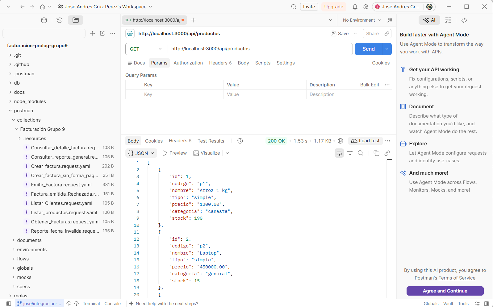
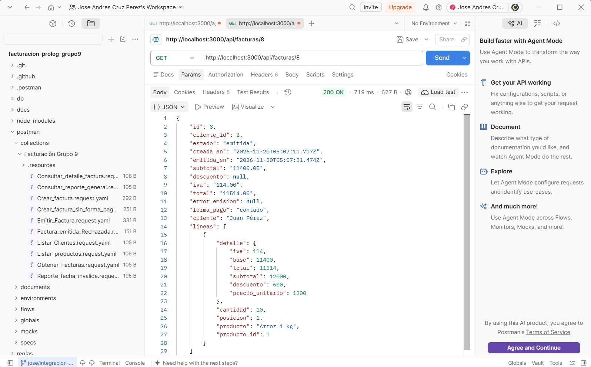
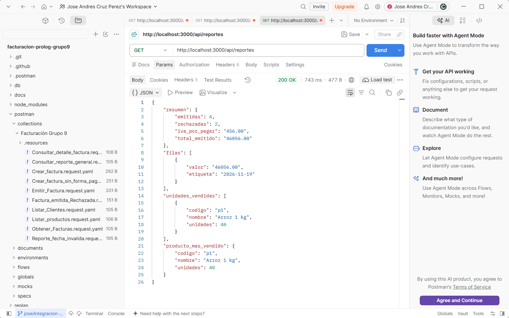

# Sistema de facturación con Prolog · Grupo 9

Proyecto de **Paradigmas de Programación** de la Universidad Fidélitas. El sistema permite crear borradores de facturas, emitirlos con reglas de negocio en Prolog y consultar el historial y los reportes de ventas.

## Integrantes

- José Andrés Cruz Pérez
- Ricardo Ulate Alpizar

## Cómo funciona

La API en Node.js recibe las solicitudes y consulta los datos en PostgreSQL, alojado en Neon. Para emitir una factura, la API envía a SWI-Prolog los datos del cliente, la forma de pago, las líneas y el catálogo.

Prolog calcula los precios de productos y kits anidados, aplica descuentos e IVA, y verifica el crédito y el stock. Si la factura se emite, la API guarda los totales y el detalle por línea y descuenta el inventario en una sola transacción. Si se rechaza, guarda el motivo y conserva el stock.

## Requisitos

- Node.js 22 o posterior.
- SWI-Prolog disponible desde la terminal mediante `swipl`.
- Una base PostgreSQL en Neon.
- Postman para ejecutar las peticiones de ejemplo.

## Instalación y ejecución

1. Cloná el repositorio y abrí su carpeta raíz.
2. Creá un archivo `.env` a partir de `.env.example`. Configurá `DATABASE_URL` con la cadena que proporciona Neon y dejá `PORT=3000` para la API local. Guardá `.env` únicamente en tu equipo.
3. Desde PowerShell, ejecutá estos comandos en orden:

   ```powershell
   npm.cmd ci
   npm.cmd run db:setup -- --demo
   npm.cmd start
   ```

`db:setup -- --demo` prepara las tablas y carga los productos y clientes de ejemplo. La API queda disponible en `http://localhost:3000`.

## Endpoints

| Método | Ruta | Descripción |
| --- | --- | --- |
| GET | `/api/productos` | Lista el catálogo de productos y kits. |
| GET | `/api/clientes` | Lista los clientes disponibles. |
| GET | `/api/facturas` | Lista las facturas y sus estados. |
| GET | `/api/facturas/{id}` | Consulta una factura con sus líneas y el detalle guardado. |
| POST | `/api/facturas` | Crea un borrador y devuelve `201`. |
| POST | `/api/facturas/{id}/emitir` | Evalúa la factura con Prolog y guarda el resultado en Neon. |
| GET | `/api/reportes` | Consulta ventas, IVA por pagar, unidades vendidas y el artículo más vendido. |

### Crear y emitir una factura

Enviá `POST /api/facturas` con un cuerpo JSON como este. Usá los IDs numéricos de cliente y producto que devuelven los endpoints de catálogo.

```json
{
  "cliente_id": 2,
  "forma_pago": "contado",
  "lineas": [
    { "producto_id": 1, "cantidad": 10 }
  ]
}
```

La forma de pago acepta `contado` y `credito`. Si se omite, se usa `contado`.

Tomá el `id` del borrador y enviá `POST /api/facturas/{id}/emitir` con el cuerpo vacío. La respuesta `200` contiene el estado `emitida` o `rechazada`. En caso de rechazo, `error_emision` incluye el motivo. Si la factura ya fue emitida, la API devuelve `409`.

### Consultar reportes

Los parámetros `desde` y `hasta` son opcionales, inclusivos y usan el formato `AAAA-MM-DD`. El reporte usa la hora de Costa Rica.

```text
GET /api/reportes?desde=2026-11-01&hasta=2026-11-30
```

Las ventas, el IVA y las unidades se calculan con las facturas emitidas. Las rechazadas se muestran en un contador propio.

## Pruebas

El motor de Prolog tiene 17 pruebas automatizadas con `plunit`. Para ejecutarlas desde la raíz:

```powershell
swipl -q -s reglas/facturacion_tests.pl -g run_tests -t halt
```

GitHub Actions ejecuta esta suite en los pull requests. Las peticiones de Postman se encuentran en `postman/collections/Facturación Grupo 9/` y apuntan a la API local. Para probar la emisión, creá primero un borrador nuevo y usá su ID.

## Bitácora de IA

La bitácora del proyecto está en [`BITACORA_IA.md`](BITACORA_IA.md).

## Capturas

### Catálogo de productos


### Factura emitida


### Reporte de ventas
